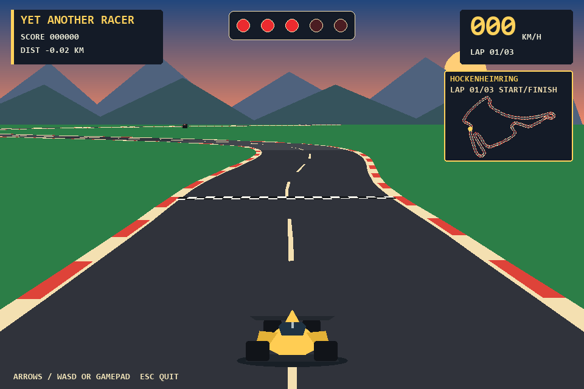
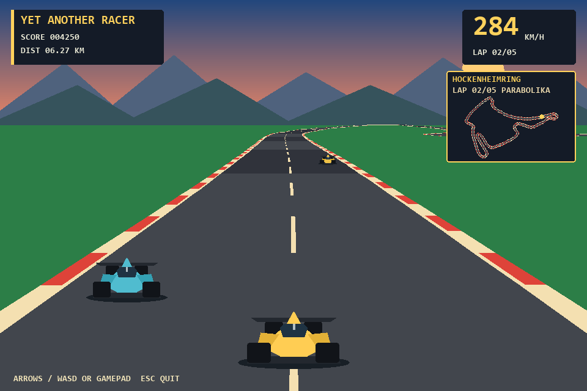
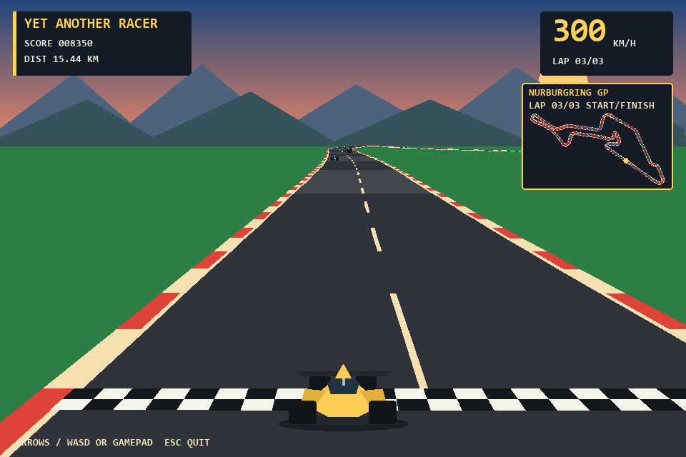
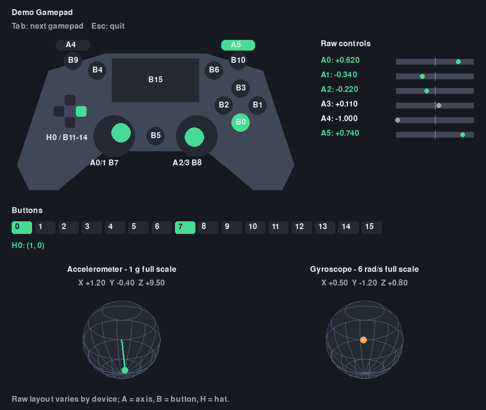

# Yet Another Racer

A small retro arcade racer built with Pygame. Steer a car along a curving road,
avoid traffic, and pass cars to build your score before the selected lap count
is complete. Choose between closed, stylized Hockenheim and Nurburgring GP
circuits, each with a live overview map.

## Gameplay

### Race Start



### On Track



### Final Approach



## Requirements

- [uv](https://docs.astral.sh/uv/)
- Python 3.10 or newer

## Bring Up

From the project directory, sync the dependencies and launch the game:

```powershell
uv sync
$env:PYTHONPATH = (Get-Location).Path
uv run python src/racer.py
```

`uv sync` creates or updates `.venv` and installs the Pygame-compatible
`pygame-ce` dependency declared in `pyproject.toml`. The repository root must
be on `PYTHONPATH` because the entry point imports modules through both `racer`
and `src.racer`.

## Controls

Before a race, use Up/Down to highlight car, track, or lap count; Left/Right
changes the highlighted value. The options screen shows the track's bird's-eye
preview. Press Enter or Space to start.

The car waits stationary on the grid before the start/finish line while five
red lights count down. Driving starts when they go out.

| Input | Action |
| --- | --- |
| Up/Down, D-pad vertical, or left stick Y before race | Select option |
| Left/Right, D-pad horizontal, or left stick X before race | Change selected value |
| Enter or Space before race | Start race |
| Up arrow or W; right shoulder trigger | Accelerate |
| Down arrow or S; left shoulder trigger | Brake |
| Left arrow or A; left stick or D-pad left | Steer left |
| Right arrow or D; left stick or D-pad right | Steer right |
| R | Return to options after race completion |
| Esc | Quit |

The left stick's horizontal axis 0 or the D-pad steers. The right shoulder trigger uses
axis 5 for linear acceleration: -1 is zero, 0 is half, and +1 is full throttle.
The left shoulder trigger uses axis 4 for linear braking: -1 is no brake, 0 is
half, and +1 is hard braking.
The Simple car has 70% of F1 acceleration and 80% of F1 braking strength.
A small deadzone filters steering drift.
Before a race, D-pad and left-stick directions follow the same navigation:
vertical selects an option and horizontal changes its value. The default race
is three laps.

Collisions and driving off the road reduce speed. Collision bounds use the
selected car's physical width and length. `CONTACT!` indicates a recent hit
and remains visible for 0.9 seconds, even after the cars separate. Passing
traffic earns points.

The sun and two mountain ranges scroll as the camera turns, with distant
scenery moving more slowly than nearby scenery.

## Gamepad Visualizer

Run the live raw-input visualizer with `uv run python -m script.gamepad_visualizer`.
It also visualizes accelerometer and gyroscope vectors on 3D-style spheres and
smooths the readouts when a connected controller exposes motion sensors. The
screenshot shows a sample active input state.



## Structure

- `src/racer.py` orchestrates startup, the event loop, and shutdown.
- `src/racer/input.py` defines input contracts and adapts keyboard and gamepad input.
- `src/racer/game_state.py` contains immutable state and pure race transitions.
- `src/racer/track.py` defines the Hockenheim and Nurburgring GP centerlines.
- `src/racer/rendering.py` draws frames from state without changing it.
- [Software Architecture](doc/software_architecture.md) describes the application modules and runtime flow.
- [Software Requirements Specification](doc/requirements.md) records functional requirements and verification cases.
