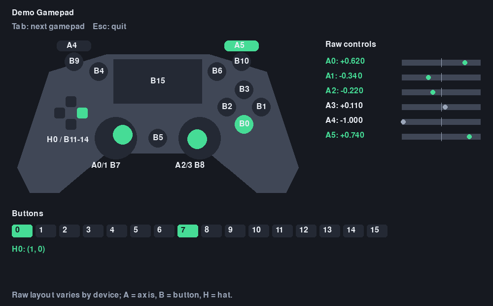

# Yet Another Racer

A small retro arcade racer built with Pygame. Steer a car along a curving road,
avoid traffic, and pass cars to build your score before the 90-second timer runs
out.


## Requirements

- [uv](https://docs.astral.sh/uv/)
- Python 3.10 or newer

## Bring Up

From the project directory, sync the dependencies and launch the game:

```powershell
uv sync
uv run python src/racer.py
```

`uv sync` creates or updates `.venv` and installs the Pygame-compatible
`pygame-ce` dependency declared in `pyproject.toml`.

## Controls

Before a race, use Left/Right or A/D to preview and select a car, then press
Enter or Space to start.

| Input | Action |
| --- | --- |
| Up arrow or W; right shoulder trigger | Accelerate |
| Down arrow or S; left shoulder trigger | Brake |
| Left arrow or A; left stick left | Steer left |
| Right arrow or D; left stick right | Steer right |
| R | Restart after time expires |
| Esc | Quit |

The left stick's horizontal axis 0 steers. The right shoulder trigger uses
axis 5 for linear acceleration: -1 is zero, 0 is half, and +1 is full throttle.
The left shoulder trigger uses axis 4 for linear braking: -1 is no brake, 0 is
half, and +1 is hard braking.
The Simple car has 70% of F1 acceleration and 80% of F1 braking strength.
A small deadzone filters steering drift.

Collisions and driving off the road reduce speed. Passing traffic earns points.

## Gamepad Test

Run the live raw-input visualizer with `uv run python -m script.gamepad_test`.
The screenshot shows a sample active input state.



## Structure

- `src/racer.py` orchestrates startup, the event loop, and shutdown.
- `src/racer/input.py` defines input contracts and adapts keyboard and gamepad input.
- `src/racer/game_state.py` contains immutable state and pure race transitions.
- `src/racer/rendering.py` draws frames from state without changing it.
- [Software Architecture](doc/software_architecture.md) describes the application modules and runtime flow.
- [Software Requirements Specification](doc/requirements.md) records functional requirements and verification cases.
