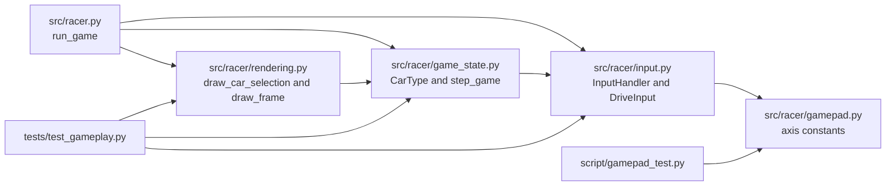
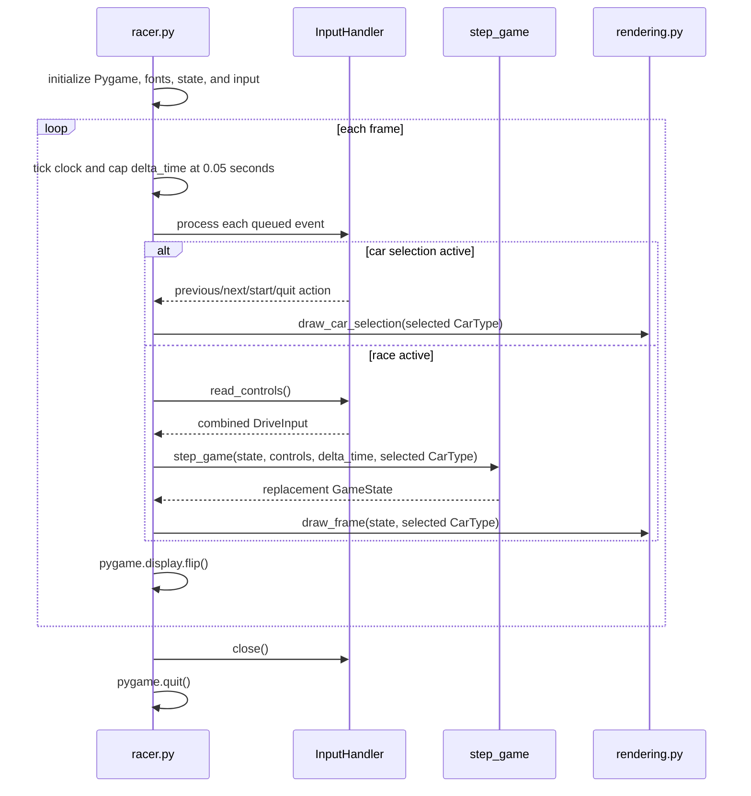
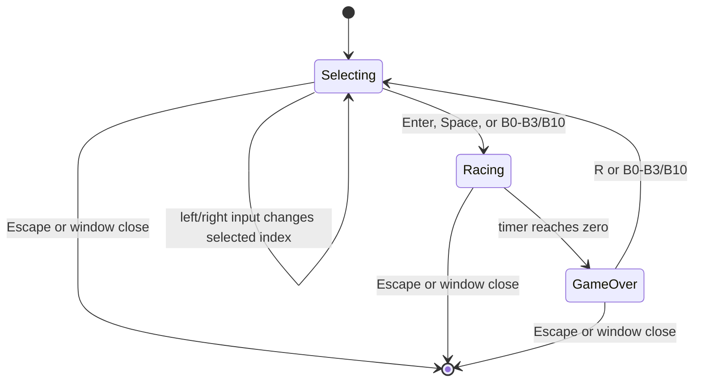

# Software Architecture

## Scope

Yet Another Racer is a single-process Pygame arcade racer. Its main application combines a real-time event loop, keyboard and joystick input, a deterministic race-state transition, and software-drawn scenery and cars. The repository also contains a standalone raw-gamepad visualizer. It has no network service, persistence layer, or external game engine; none is declared in the project configuration.

## Architecture

The application uses a small module-oriented architecture. `src/racer.py` owns Pygame startup and the frame loop; `src/racer/input.py` translates device events and current controls; `src/racer/game_state.py` computes immutable race-state snapshots; and `src/racer/rendering.py` draws those snapshots. The simulation does not draw, and the renderer does not update game state. `src/racer.py` passes the selected `CarType` to both simulation and rendering.



`src/racer/game_state.py` imports `DriveInput` from `src/racer/input.py`, so the simulation consumes the input module's control contract. Rendering imports `GameState`, `CarType`, and `CAR_TYPES` from `src/racer/game_state.py`. The dependency direction is simple but not a fully isolated domain layer: the simulation depends on the input module, while input itself does not depend on game state.

## Components

| File | Responsibility and important symbols |
| --- | --- |
| [`src/racer.py`](../src/racer.py) | Application entry point. `run_game()` initializes Pygame, maintains the selected car and selection/race mode, processes events, advances the simulation, draws a frame, and presents it with `pygame.display.flip()`. |
| [`src/racer/input.py`](../src/racer/input.py) | Input contract and gameplay adapter. `DriveInput` carries normalized throttle, brake, and steering; `InputAction` represents discrete menu, restart, and quit actions; `InputHandler` owns one gameplay joystick and handles its lifecycle. |
| [`src/racer/gamepad.py`](../src/racer/gamepad.py) | Shared axis indices and raw-device helper types. `GamepadState` snapshots axes, buttons, and hats; `Gamepads` tracks multiple devices by instance ID. The gameplay `InputHandler` currently polls a joystick directly rather than using `Gamepads`; the helper is used by the visualizer. |
| [`src/racer/game_state.py`](../src/racer/game_state.py) | Immutable domain data and simulation. `CarType`, `TrafficCar`, and `GameState` are frozen dataclasses. `new_game()` creates a fresh race and `step_game()` returns the next state. |
| [`src/racer/rendering.py`](../src/racer/rendering.py) | Pygame drawing routines. It projects road segments, draws the background and parallax, cars, HUD, selection preview, and game-over overlay. It receives state and selected car data rather than mutating them. |
| [`script/gamepad_test.py`](../script/gamepad_test.py) | Optional controller diagnostic window. It draws a generic controller silhouette and live raw axis/button/hat readouts, and supports switching between attached devices with Tab. |
| [`tests/test_gameplay.py`](../tests/test_gameplay.py) | `unittest` coverage for input mapping, selection events, state transitions, braking/acceleration/steering, traffic-car rendering, and background layering/parallax. |

## Domain Types and Contracts

- `CarType` holds a rendering `shape`, menu `name`, and relative `acceleration` and `braking` multipliers. `CAR_TYPES` contains the Formula model (`1.0`, `1.0`) and Classic model (`0.7`, `0.8`). These values are used directly by `step_game()` and the render path.
- `DriveInput` is a frozen value object with `accelerate`, `brake`, and `steering` floats. The gameplay adapter produces throttle and brake in `[0, 1]`; steering is a normalized left/right value. `combine_controls()` takes the largest throttle and brake from active sources and sums steering before clamping it to `[-1, 1]`.
- Gamepad axis constants in `gamepad.py` define left-stick axes `(0, 1)`, right-stick axes `(2, 3)`, left-trigger axis `4`, and right-trigger axis `5`. Gameplay uses left-stick horizontal axis 0 for steering, axis 4 for braking, and axis 5 for acceleration. Trigger values are mapped linearly from `[-1, 1]` to `[0, 1]`; an absent trigger axis defaults to `-1`, or zero input. Steering values within `JOYSTICK_DEADZONE` (`0.18`) of zero are set to zero.
- Keyboard arrows and WASD produce digital values (`0.0` or `1.0`) for throttle/brake and `-1.0`, `0.0`, or `1.0` for steering. Keyboard and gamepad values are combined by `InputHandler.read_controls()`.
- `GameState` is a frozen snapshot containing race distance, speed, lateral position, timer, score, crash timer, game-over flag, traffic tuple, and next traffic identifier. `TrafficCar` stores track distance, lane, and RGB color.

## Runtime Flow



`run_game()` begins in car selection with index zero. Left/Right or A/D and left-stick horizontal movement change that index with wraparound. `InputHandler` emits at most one selection action per joystick deflection; returning the stick inside the deadzone re-arms it. Enter, Space, or gamepad buttons B0–B3/B10 starts the race. Starting creates a fresh `GameState` but leaves the selected index intact.

During a race, each frame processes queued events before polling held controls. When the timer reaches zero, `step_game()` marks the state game over and subsequent calls return that state unchanged; the renderer draws its game-over overlay. `R`, or B0–B3/B10, returns to car selection. The selected index is retained, and a fresh race state is created when the player starts again. Escape or a window-close event exits the loop. The `finally` block closes the input handler and quits Pygame.

## Simulation and Rendering Details

`step_game()` is a pure transition: it returns a `dataclasses.replace()` copy and does not mutate the supplied `GameState`. It returns the original state unchanged once `game_over` is true. For active races, throttle and brake are clamped to `[0, 1]`; speed is updated using the selected car's factors and then clamped to `[0, MAX_SPEED]`:

```text
speed += (140 * throttle * car_type.acceleration - 14) * delta_time
speed -= 180 * brake * car_type.braking * delta_time
```

The steering gain is `MAX_STEERING_RATE * (speed / MAX_SPEED)`, so the steering contribution is zero at rest and increases with speed. A separate sinusoidal road term adds curve-induced lateral drift, and lateral position is clamped to `[-1.12, 1.12]`. Leaving the road (`abs(lateral) > 0.94`) reduces speed; collisions are checked against traffic using the newly computed distance and lateral position, and reduce speed while setting `crash_time`. Distance advances using `speed * 0.44704` and a world-speed factor that increases linearly from 1 to 2 across the speed range. The timer always decreases by real `delta_time`.

Traffic is initialized deterministically with ten cars at fixed track-distance intervals. Each update removes cars more than 12 distance units behind the player and counts them as passed for scoring. If no traffic remains, or the farthest car is less than 1500 units ahead, `_advance_traffic()` creates another car using the next identifier. Lane and color are selected deterministically from that identifier.

The renderer projects 76 road segments between the horizon and screen bottom. `road_curve()`, `road_center()`, and `road_width()` produce the perspective geometry; curb stripes and lane markings are drawn per segment. Traffic is sorted far-to-near, culled outside the road lookahead, and drawn with the selected car shape. The background uses the current road bend to offset two mountain layers and the sun in the opposite direction, with the nearer mountain layer moving more. The sun is drawn before the mountains, so mountains occlude it where they overlap.

## State and Input Lifecycle



The menu/race mode is held by `selecting_car` in `racer.py`; race completion is held separately in `GameState.game_over`. Returning to selection does not clear or reset the selected car index. Device connection events are handled by `InputHandler.process_event()`: it connects an available joystick at startup, handles device-added events when none is open, and on removal attempts to reconnect device index 0. `close()` quits the active joystick and the Pygame joystick subsystem.

## Tests and Checks

Tests use Python's built-in `unittest` framework; the current gameplay, input, and rendering tests are in `tests/test_gameplay.py`. From the repository root, synchronize dependencies and run the game with:

```powershell
uv sync
uv run python src/racer.py
```

Run the test suite with:

```powershell
uv run python -m unittest discover -s tests
```

The configured Ruff checks are:

```powershell
uv run ruff check .
uv run ruff format --check .
```

The project targets Python 3.10 or newer and declares `pygame-ce` in `pyproject.toml`; the lockfile currently resolves `pygame-ce` 2.5.8. `pyproject.toml` sets an 80-character line length for Black and Ruff and has Pylint formatting/typecheck/design settings. `.flake8` also sets an 80-character limit. The repository does not declare Ruff, Black, Pylint, or pytest as project dependencies.

The raw controller visualizer can be launched separately from the repository root with:

```powershell
uv run python -m script.gamepad_test
```
