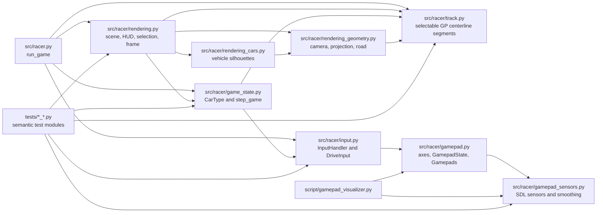
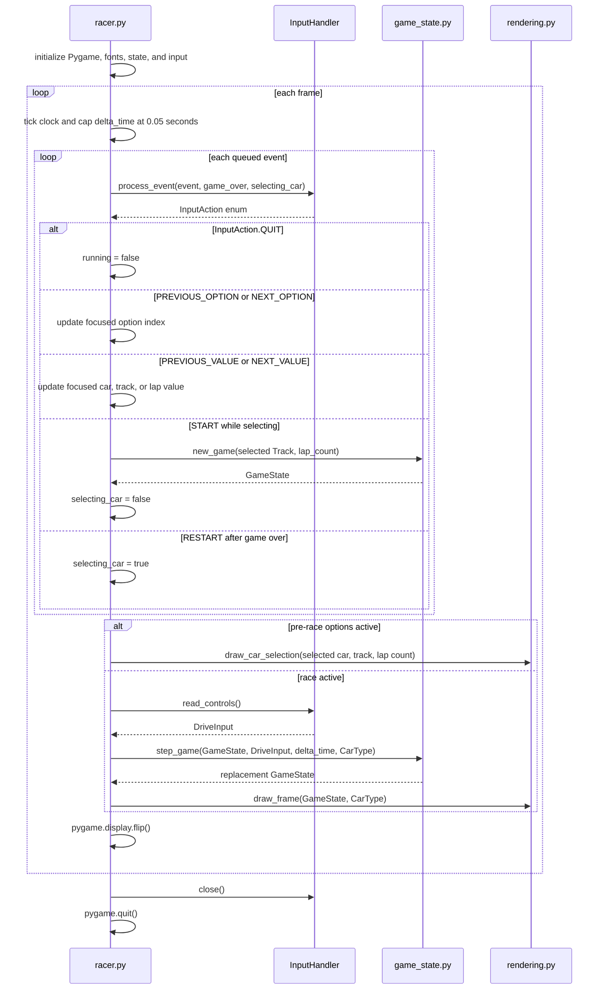
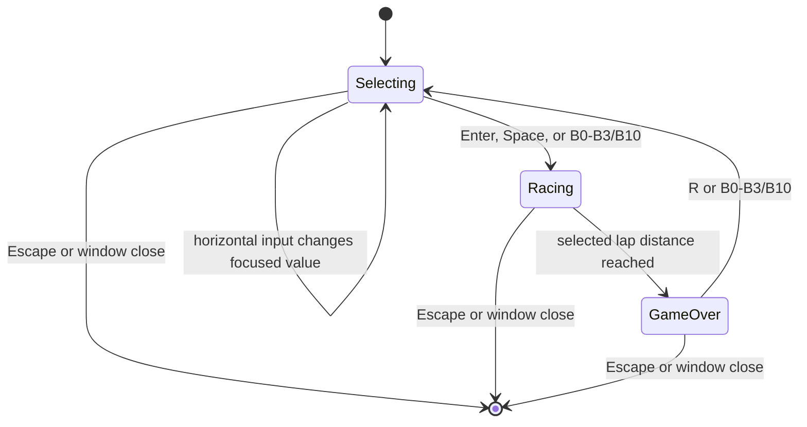

# Software Architecture

## Scope

Yet Another Racer is a single-process Pygame arcade racer. Its main application combines a real-time event loop, keyboard and joystick input, a deterministic race-state transition, and software-drawn scenery and cars. The repository also contains a standalone raw-gamepad visualizer. It has no network service, persistence layer, or external game engine; none is declared in the project configuration.

## Architecture

The application uses a small module-oriented architecture. `src/racer.py` owns Pygame startup and the frame loop; `src/racer/input.py` translates device events and current controls; `src/racer/game_state.py` computes immutable race-state snapshots; and the rendering modules draw those snapshots. `src/racer/rendering.py` remains the scene/UI entry point and compatibility facade; camera and road projection live in `rendering_geometry.py`, while car silhouettes live in `rendering_cars.py`. The simulation does not draw, and rendering does not update game state. `src/racer.py` passes the selected `CarType` to both simulation and rendering.

The flowchart below shows module dependencies, the sequence diagram shows runtime messages and their object types, and the statechart shows the menu/race lifecycle. The dependency flowchart is a module-level view rather than a strict UML component diagram; arrows represent direct imports or test dependencies.



`src/racer/game_state.py` imports `DriveInput` from `src/racer/input.py`, so the simulation consumes the input module's control contract. Rendering imports `GameState`, `CarType`, and `CAR_TYPES` from `src/racer/game_state.py`. The dependency direction is simple but not a fully isolated domain layer: the simulation depends on the input module, while input itself does not depend on game state.

## Components

| File | Responsibility and important symbols |
| --- | --- |
| [`src/racer.py`](../src/racer.py) | Application entry point. `run_game()` initializes Pygame, maintains the selected car and selection/race mode, processes events, advances the simulation, draws a frame, and presents it with `pygame.display.flip()`. |
| [`src/racer/input.py`](../src/racer/input.py) | Input contract and gameplay adapter. `DriveInput` carries normalized throttle, brake, and steering; `InputAction` represents option focus/value, start, restart, and quit actions; `InputHandler` owns one gameplay joystick and handles its lifecycle. |
| [`src/racer/gamepad.py`](../src/racer/gamepad.py) | Shared axis indices and raw-device helper types. `GamepadState` snapshots axes, buttons, hats, and available motion sensors; `Gamepads` tracks multiple devices by instance ID. The gameplay `InputHandler` currently polls a joystick directly rather than using `Gamepads`; the helper is used by the visualizer. |
| [`src/racer/gamepad_sensors.py`](../src/racer/gamepad_sensors.py) | Reads SDL game-controller accelerometer and gyroscope data when available and smooths sensor samples per device. |
| [`src/racer/game_state.py`](../src/racer/game_state.py) | Immutable domain data and simulation. `CarType`, `TrafficCar`, and `GameState` are frozen dataclasses. `new_game()` creates a lap-limited race and `step_game()` returns the next state. |
| [`src/racer/track.py`](../src/racer/track.py) | Deterministic Hockenheim and Nürburgring GP centerlines, sampled segment metadata, and wrapped distance sampling shared by race state and rendering. |
| [`src/racer/rendering.py`](../src/racer/rendering.py) | Rendering facade and scene/UI composition. Draws backgrounds, traffic, HUD, selection preview, and game-over overlay; keeps the established renderer import surface. |
| [`src/racer/rendering_geometry.py`](../src/racer/rendering_geometry.py) | Camera transforms, perspective projection, near-plane clipping, road strips, and the world-anchored start line. |
| [`src/racer/rendering_cars.py`](../src/racer/rendering_cars.py) | Formula and Classic vehicle silhouette drawing used for the player and traffic. |
| [`script/gamepad_visualizer.py`](../script/gamepad_visualizer.py) | Optional controller visualizer window. It draws a generic controller silhouette, live raw axis/button/hat readouts, and available accelerometer/gyroscope values, and supports switching between attached devices with Tab. |
| [`tests/test_input.py`](../tests/test_input.py) | `unittest` coverage for keyboard, gamepad, and option-selection input. |
| [`tests/test_track_geometry.py`](../tests/test_track_geometry.py) | `unittest` coverage for circuit landmarks, sector order, and lap continuity. |
| [`tests/test_game_state.py`](../tests/test_game_state.py) | `unittest` coverage for race transitions, lap completion, and vehicle physics. |
| [`tests/test_gamepad_sensors.py`](../tests/test_gamepad_sensors.py) | `unittest` coverage for SDL sensor access and sample smoothing. |
| [`tests/test_rendering.py`](../tests/test_rendering.py) | `unittest` coverage for track previews, world-space road projection, traffic, and rendering behavior. |

## Domain Types and Contracts

- `CarType` holds a rendering `shape`, menu `name`, and relative `acceleration` and `braking` multipliers. `CAR_TYPES` contains the Formula model (`1.0`, `1.0`) and Classic model (`0.7`, `0.8`). These values are used directly by `step_game()` and the render path.
- `DriveInput` is a frozen value object with `accelerate`, `brake`, and `steering` floats. The gameplay adapter produces throttle and brake in `[0, 1]`; steering is a normalized left/right value. `combine_controls()` takes the largest throttle and brake from active sources and sums steering before clamping it to `[-1, 1]`.
- Gamepad axis constants in `gamepad.py` define left-stick axes `(0, 1)`, right-stick axes `(2, 3)`, left-trigger axis `4`, and right-trigger axis `5`. Gameplay uses left-stick horizontal axis 0 and D-pad horizontal input for steering, axis 4 for braking, and axis 5 for acceleration. Trigger values are mapped linearly from `[-1, 1]` to `[0, 1]`; an absent trigger axis defaults to `-1`, or zero input. Stick steering values within `JOYSTICK_DEADZONE` (`0.18`) of zero are set to zero.
- Keyboard arrows and WASD produce digital values (`0.0` or `1.0`) for throttle/brake and `-1.0`, `0.0`, or `1.0` for steering. Keyboard and gamepad values are combined by `InputHandler.read_controls()`.
- Before a race, Up/Down, D-pad vertical, or left-stick Y changes the focused option; Left/Right, D-pad horizontal, or left-stick X changes its value.
- `GameState` is a frozen snapshot containing race distance, speed, lateral position, lap count, start-light countdown, heading error, score, crash timer, game-over flag, traffic tuple, next traffic identifier, and selected `Track`. The race ends at `track.length * lap_count`. `TrafficCar` stores track distance, lane, and RGB color.

## Runtime Flow



`run_game()` begins in pre-race options with the first car and track and the default three-lap target selected. Up/Down, D-pad vertical, or left-stick Y moves the highlight among car, track, and lap count. Left/Right, D-pad horizontal, or left-stick X changes the highlighted value. Values wrap around. `InputHandler` emits at most one selection action per stick deflection; returning that axis inside the deadzone re-arms it. Enter, Space, or gamepad buttons B0–B3/B10 starts a fresh `GameState` with the selected car, track, and lap count. The car starts at zero speed, 18 meters before the line, and remains stationary while the five-second light countdown runs.

During a race, each frame processes queued events before polling held controls. When distance reaches `track.length * lap_count`, `step_game()` clamps at the finish line, marks the state game over, and subsequent calls return that state unchanged; the renderer draws its race-complete overlay. After game over, `R` or B0–B3/B10 returns to options while retaining all selections. Escape or a window-close event exits the loop. The `finally` block closes the input handler and quits Pygame.

## Simulation and Rendering Details

`step_game()` is a pure transition: it returns a `dataclasses.replace()` copy and does not mutate the supplied `GameState`. It returns the original state unchanged once `game_over` is true. For active races, throttle and brake are clamped to `[0, 1]`; speed is updated using the selected car's factors and then clamped to `[0, MAX_SPEED]`:

```text
speed += (42 * throttle * car_type.acceleration - 8) * delta_time
speed -= 100 * brake * car_type.braking * delta_time
```

Speed is expressed in km/h and converted to meters per second using `speed / 3.6`. Steering uses a 2.7-meter wheelbase and a speed-sensitive steering angle, sized to hold typical tight bends at low speed while reducing steering response at high speed. `GameState.heading_error` records vehicle heading relative to the centerline tangent; the actual road heading change updates this error as the car advances. Forward progress accounts for heading and the lateral offset's turn radius, while lateral movement follows the vehicle heading. There is no independent sine-wave drift or world-speed multiplier. Curb contact remains within the road boundary. On grass beyond lateral offset 1.1, engine acceleration is reduced and drag scales with speed, allowing a stopped car to accelerate and steer back onto the circuit. Lateral position remains clamped to `[-1.12, 1.12]`. Collisions reduce speed. This remains simplified arcade handling, not a tire or suspension simulation.

Traffic is initialized deterministically with ten cars at fixed track-distance intervals. Each update removes cars more than 12 distance units behind the player and counts them as passed for scoring. If no traffic remains, or the farthest car is less than 1500 units ahead, `_advance_traffic()` creates another car using the next identifier. Lane and color are selected deterministically from that identifier.

`track.py` builds separate sampled centerlines for Hockenheim (4,574 meters) and Nürburgring GP (5,148 meters) from closed Catmull-Rom waypoint spans. Each segment stores its start distance, length, world position, heading, curvature, elevation, grade, and named sector. The geometries follow the broad shapes and turn sequences of the supplied bird's-eye maps, but remain approximations rather than surveyed coordinates. `sample_track()` wraps race distance and interpolates centerline data across segment and lap boundaries for a selected `Track`.

Road strips are fixed in world coordinates at 3-meter distance intervals with a 13-meter width. Their edges use the same centerline position and tangent as physics and the overview map. Centerline position is interpolated smoothly and heading is derived from its tangent, including across lap boundaries. A chase camera sits 8 meters behind the player and 4.5 meters above the road; world vertices are transformed into camera coordinates, clipped at a 1-meter near plane, and projected by dividing by forward depth. Visible road strips out to 450 meters are sorted back-to-front. Per-frame projected cross-sections are reused for asphalt, curbs, edge lines, and center dashes. Traffic and the player use the same camera and meter scale. The checkered start-line tiles are world-space road polygons at distance zero, so they share the road perspective and repeat at the lap boundary. The five red start lamps extinguish in sequence during the countdown. The map marker includes the player's lateral offset. The pre-race options screen shows a larger bird's-eye preview of the selected track. Background parallax remains decorative and does not influence road geometry or driving.

## State and Input Lifecycle



The menu/race mode is held by `selecting_car` in `racer.py`; race completion is held separately in `GameState.game_over`. Returning to options retains both selected indices. Device connection events are handled by `InputHandler.process_event()`: it connects an available joystick at startup, handles device-added events when none is open, and on removal attempts to reconnect device index 0. `close()` quits the active joystick and the Pygame joystick subsystem.

## Tests and Checks

Tests use Python's built-in `unittest` framework and are split by responsibility across modules in `tests/`. From the repository root, synchronize dependencies and run the game with:

```powershell
uv sync
$env:PYTHONPATH = (Get-Location).Path
uv run python src/racer.py
```

The repository root is added to `PYTHONPATH` because the entry point imports `racer` from `src`, while the shared gamepad helper also imports through the `src.racer` namespace.

Run the test suite with:

```powershell
uv run python -m unittest discover -s tests
```

The configured Ruff checks are:

```powershell
uv run ruff check .
uv run ruff format --check .
```

The project targets Python 3.10 or newer and declares `pygame-ce` in `pyproject.toml`; the lockfile currently resolves `pygame-ce` 2.5.8. `pyproject.toml` sets an 80-character line length for Black and Ruff and has Pylint formatting/typecheck/design settings. `.flake8` also sets an 80-character limit. The repository does not declare Ruff, Black, Pylint, or pytest as project dependencies.

The raw controller visualizer can be launched separately from the repository root with:

```powershell
uv run python -m script.gamepad_visualizer
```
